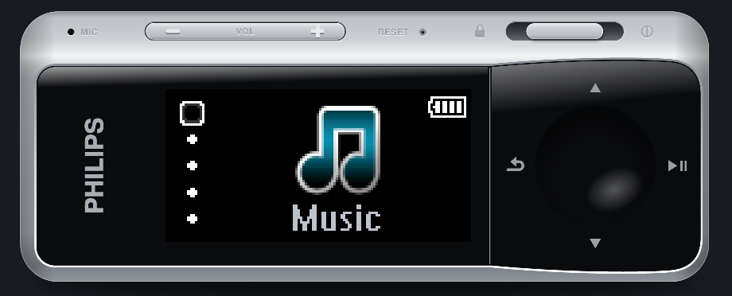
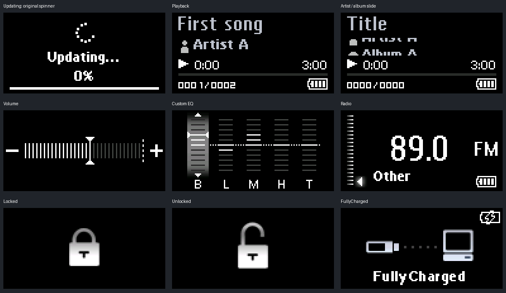

# Philips GoGear Mix

A Windows music player that brings the GoGear Mix back to the desktop: the
device body, tiny 128x64 screen, original graphics and fonts, bubble menus,
scrolling metadata, and those slightly dramatic boot and shutdown animations.

The other half of this project is the firmware investigation behind it.
Extracted resources, ARM/Thumb analysis, function dossiers and UI notes live
alongside the player source. The desktop app uses FFmpeg and Windows audio;
it reconstructs the interface rather than running the original firmware.





## Device and firmware

| Field | Value |
| --- | --- |
| Device | Philips GoGear Mix |
| Model | **SA1MXX04K/37** |
| Firmware version | **1.21.0** - product and component BCD `0001.0021.0000` |
| Firmware container | SigmaTel/STMP SB **1.1** |
| SB header timestamp | **2009-08-26 10:18:00**, decoded using the SB epoch |
| USB vendor/product ID | `0471:2070` |
| Firmware image | [`20261110T141045Z/firmware.sb`](20261110T141045Z/firmware.sb) |
| Image size | 9,000,928 bytes |
| Physical FM radio | Not fitted on this model; desktop radio is an internet adapter |

Firmware SHA-256:

```text
f0565f2861cb5aaec78821ce2017c77ca222422a28e0a9ea72aa4db579a5d7ad
```

The model is identified in the capture notes. Version fields, container format,
timestamp and integrity checks are recorded in the
[initial findings](re/docs/INITIAL_FINDINGS.md). The timestamp is an SB header
field, not an independently verified compilation date. The capture preserves
logical partitions; it is not a complete raw NAND/OOB or boot-ROM dump.

## The desktop player

- Original firmware graphics, bitmap fonts and 24 language tables, with Dark,
  Blue and Pink themes.
- Recursive music library, artists, albums, folder browsing and Playlist-on-the-Go.
- FFmpeg playback through Windows waveOut, with pause, track changes, seeking,
  repeat, shuffle, five-band EQ and a volume limit.
- A title that scrolls once, then makes room for the sliding artist/album row.
- Original volume graphics, full-screen lock/unlock feedback, confirmation
  layouts, and a Connected-to-PC preview with the prerendered `FullyCharged` text.
- Microphone recording to mono 22.05 kHz WAV files under `Recordings/Voice/`.
- Editable internet stations behind a virtual 87.5-108.0 MHz dial. Radio is a
  hidden sixth home item after Now/Last Played; the original five-dot rail stays.
- Slower boot/shutdown animations and a three-second `Updating...` screen.

Run `philips.exe` from the portable package with its four FFmpeg DLLs beside it.
Put your files in `Music/`; nested folders work. The player creates missing
runtime folders and templates without replacing existing files.

```text
philips.exe
avcodec-*.dll
avformat-*.dll
avutil-*.dll
swresample-*.dll
Music/
Recordings/Voice/
Playlists/
  Playlist-on-the-Go.m3u8
  radio.json
  radio.example.json
```

Settings and the last playback position are stored in `philips.ini` beside the
executable. Portable ZIPs contain empty media folders and clean playlist/radio
templates, never the local music library or station configuration.

### Controls

| Control | Action |
| --- | --- |
| Up / Down | Browse; during playback, tap for previous/next or hold to seek |
| Left / Backspace / Escape | Back; hold for main menu in ordinary menus |
| Right / Enter / Space | Select or play/pause |
| Shift + Up / Down | Seek five seconds; on radio, jump between configured stations |
| `+` / `-` | Volume; the "- VOL +" rocker on the top surface has clickable ends |
| Slider on the top surface | Left latches Lock; center unlocks; hold spring-return right for power-off |
| `L` / hold `P` | Toggle lock / hold power-off |
| Right click | Swap between the frameless floating player and an ordinary window |
| `T` / Alt+Space > Always on top | Toggle always on top; remembered across restarts |
| Drag the shell / its lower-right corner mark | Move / resize the frameless player |
| Home | Main menu |
| `M` | Current-track shortcuts, or radio options |
| `S` / `R` | Shuffle / cycle repeat modes |
| F5 | Rescan media and reload stations |
| F7 / F8 | Battery charge down / up one step |
| F9 / F10 | Connected-to-PC / charge-choice previews |
| F11 | Switched-off-and-charging preview |

The marks on the control plate and the menu rows are clickable. Held volume and navigation keys
repeat; short actions complete on release. Confirmations use Play/OK and
Back/Cancel; Up/Down does not choose an answer. The M track menu is a desktop
shortcut, while Music > Playlists follows the recovered original menu.
Back from playback restores the remembered browser cursor; it does not move
the highlight to a different track just because playback advanced.

For stations, edit `Playlists/radio.json`:

```json
{
  "stations": [
    {
      "mhz": 99.5,
      "name": "My station",
      "url": "https://example.invalid/live.mp3"
    }
  ]
}
```

That URL is a placeholder. The supplied `radio.json` starts empty; use the
example file for the schema and supply working HTTP(S) stream URLs. Unmapped
frequencies stay silent.

See [PLAYER.md](PLAYER.md) for the full runtime guide, recording behavior,
diagnostic arguments and Windows test procedure.

## Build from Linux

Requirements:

- GNU Make, Python 3 and OpenSSL.
- A Python environment at `../.venv` with the `resvg-py` package, and the URW
  Nimbus Sans Bold font, for prerendering the shell drawing.
- Native `g++` with C++17 support for UI tests.
- MinGW-w64 `x86_64-w64-mingw32-g++-posix` and `x86_64-w64-mingw32-windres`.
- A Windows x64 FFmpeg shared SDK under `third_party/ffmpeg/`, with `include/`,
  `lib/`, `bin/` and `LICENSE.txt`. The SDK used here and its archive hash are
  documented in [third_party/FFMPEG.md](third_party/FFMPEG.md).

The extraction scripts are in `tools/` and use only the Python standard library:
`sb_extract.py` (which also calls the installed `openssl`), `stmp_rsrc.py` and
`pngw.py`. `make map-vmi` reuses the first; exporting standalone host-mode PNGs
uses the third.

From this repository's root, prepare the assets once:

```sh
python3 -I tools/sb_extract.py 20261110T141045Z/firmware.sb gen/sb
python3 -I tools/stmp_rsrc.py gen/sb/05_rsrc.bin gen/resources
```

Both extractors require a new destination directory. Keep the original capture
unchanged; generated analysis files belong under `gen/`.

Then build and package:

```sh
make test-ui
make test-audio
make test-keys
make package
```

Outputs are `dist/philips.exe` and `dist/philips-win64.zip`. C++/threading
runtimes link statically; FFmpeg remains shared. Playback uses the libraries
directly and does not launch `ffmpeg.exe`.

`make test-ui` runs the actual shared renderer/controller with fake audio and
microphone services. It checks resource pixels, animation sequencing, menus,
confirmation actions, injected full-screen failures and popup click guards,
recording decisions, radio JSON and EQ behavior. It does
not establish real microphone or network operation on Windows. For decoder and
runtime checks, run `tools/test_windows.ps1` on Windows as described in PLAYER.md.

`make test-audio` checks the bounded two-second PCM read-ahead buffer, including
sample ordering, decoder stalls, seek/stop cancellation and EOF/error tails.
Playback prefills before starting Windows output; see
[the buffering audit](docs/AUDIO_BUFFERING.md) for the design and validation limits.

`make test-keys` checks held-key repeat, seek acceleration, safe modal transitions,
wake/lock suppression and the spring-return power slider. Firmware event and
timer evidence is in [KEY_BEHAVIOR.md](re/docs/KEY_BEHAVIOR.md); exact physical
tick duration remains unverified.

## Firmware research

The SB image contains encrypted `boot`, `host` and `play` sections plus clear
`hvmi`, `pvmi` and `rsrc` sections. Integrity checks pass for the header, complete
image, command checksums and all 47 LOAD CRCs. Extracted assets include 322 RSRC
UI images and a separate 48-image host-mode table containing the PC connection
graphics. VMI mappings and analysis-only ELF wrappers make the ARM/Thumb UI code
available for static analysis.

| Location | Contents |
| --- | --- |
| [`20261110T141045Z/`](20261110T141045Z/) | Original capture and verification metadata |
| `src/` | Win32 shell, portable UI, FFmpeg audio, microphone recorder and configuration |
| `assets/Playlists/` | Clean runtime templates |
| `assets/shell/shell.svg` | The device shell drawing; the build prerenders it with resvg |
| `tools/` | Firmware and resource extraction, asset embedding, shell prerendering, host-UI extraction, VMI mapping, packaging and Windows checks |
| `tests/` | Native tests of the shared interface |
| `re/docs/` | Findings, retained evidence and function dossiers |
| `re/symbols/` | Address/name annotations for the analysis images |
| `ref/` | Original device icon and local visual references |
| `dump_tools/` | Device capture and RAM-recovery utilities, separate from the desktop build |
| `gen/`, `dist/` | Ignored extraction, test and build outputs |

Start with [FIRMWARE_UI.md](re/docs/FIRMWARE_UI.md) for recovered functions and
coordinates, or [UI_FIDELITY_AUDIT.md](re/docs/UI_FIDELITY_AUDIT.md) for what is
recovered, adapted or still unknown. The
[reconstruction notes](re/docs/UI_RECONSTRUCTION.md) explain the resource layout
and discovery of the separate USB screen.

The goal is a close reconstruction, not a claim of firmware emulation or full
behavioral equivalence. Exact hardware timing, some regional text/dialog
behavior, original DSP coefficients, audiobook gates and power management still
need investigation. Internet radio, Windows recording and the M shortcut menu
are deliberate desktop adaptations.

Original firmware, artwork, fonts and `DEVICON.FIL` come from the captured
Philips software. FFmpeg dependency and licensing information is kept in
[third_party/FFMPEG.md](third_party/FFMPEG.md).
